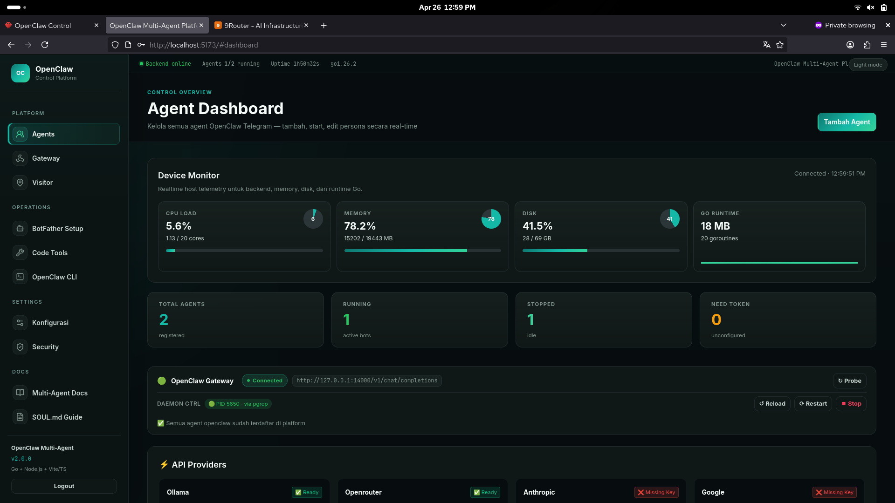

<p align="center">
  <h1 align="center">🐾 OpenClaw Multi-Agent Platform</h1>
  <p align="center">
    <strong>Pusat kendali terpusat untuk menjalankan dan mengelola multiple OpenClaw AI Agents.</strong>
  </p>
</p>

---

## 📖 Apa itu OpenClaw Multi-Agent Platform?




Platform ini adalah **orchestrator** (pusat kendali) yang memungkinkan Anda untuk menjalankan, memonitor, dan mengonfigurasi banyak **Agent AI Telegram (OpenClaw)** secara bersamaan di atas satu perangkat/server, semuanya melalui **web dashboard** yang bersih dan modern.

Daripada menjalankan skrip bot satu per satu di terminal yang terpisah, platform ini menyatukan semuanya. Anda dapat dengan mudah melakukan *start/stop* agen, melihat *live logs*, mengedit kepribadian agen, hingga mengatur memori jangka panjang mereka—semua dari antarmuka web.

## ✨ Fitur Utama

- 🤖 **Multi-Agent Orchestration**: Jalankan berbagai agen AI dengan persona dan tugas yang berbeda secara paralel.
- 🎛️ **Web Dashboard Interaktif**: UI modern (Vite) untuk kendali penuh atas semua agen secara real-time.
- 🧰 **Code Tools Runtime**: Install/validate/start/stop Claude Code, OpenCode, `9router`, dan `omniroute` dari dashboard dengan log runtime SSE.
- 🧭 **OpenClaw CLI Console**: Command map OpenClaw yang dikurasi, read-only/mutating policy, konfirmasi untuk perubahan, dan output redaction.
- 🔀 **Dynamic AI Router Dashboard**: Menu **AI Router** muncul otomatis hanya saat `9router` atau `omniroute` aktif sebagai private loopback router.
- 🔑 **Provider Configuration**: Simpan dan validasi provider model secara terpusat tanpa menulis secret ke source code.
- 🧠 **Cognitive Persistence Memory**: Integrasi dengan **PostgreSQL + pgvector** untuk memberikan agen ingatan jangka panjang (RAG / Semantic Memory).
- 📡 **Live Telemetry & Logs**: Pantau aktivitas & pemikiran LLM tiap agen secara live via Server-Sent Events (SSE).
- 🎭 **Dynamic Persona Management**: Edit *SOUL.md* (prompt persona) masing-masing agen langsung dari dashboard.
- 🧪 **BotFather/UserBot Flow**: Bantuan pembuatan bot Telegram dan deploy sub-agent lewat tool internal yang dinonaktifkan default.
- 📊 **Security Center + Visitor Intelligence**: Policy masking, encrypted audit log, template validation, gateway visitor/risk telemetry, dan system metrics.
- 🛡️ **System Hardening**: Preview/execute hardening host tetap berada di route protected session + CSRF.

## 🆕 New Release

- **OpenClaw Iconic Branding**: dashboard sekarang memakai logo OpenClaw lokal yang reusable dan favicon browser berbasis SVG.
- **Dynamic AI Router Dashboard**: menu **AI Router** muncul otomatis setelah `9router` atau `omniroute` berhasil berjalan dari Code Tools.
- **Kontrol Runtime 9Router/OmniRoute**: dashboard router menampilkan endpoint loopback, port, status provider/model, log runtime, copy endpoint, buka `/models`, refresh, dan stop router.
- **Advanced Security Hardening**: child process Code Tools memakai allowlist environment, log CLI memakai ring buffer fan-out, output OpenClaw CLI direduksi, command baca secret/config sensitif diblokir, dan lifecycle admin masuk audit event.

---

## 🏗️ Arsitektur Sistem

```
Telegram / Webhook / Visitor
        ↓
Gateway + Node.js Bot Runners        ← satu proses per agent, token per bot
        ↓
OpenClaw Gateway (:14000)            ← LLM routing utama
        ↓ optional private downstream
9Router / OmniRoute (127.0.0.1)      ← OpenAI-compatible router lokal
        ↑
Go API Server (:8080)                ← auth, process manager, CLI runner, security store, visitor store
        ↑ REST + SSE
Vite+TS Dashboard (:5173)            ← agents, Code Tools, AI Router, Security Center, Visitor, System

Storage:
- credentials/.env + credentials/agents.json untuk konfigurasi lokal non-Git.
- credentials/security/*.enc untuk encrypted security store dan audit JSONL.
- PostgreSQL/pgvector untuk memory agent dan optional gateway_visitors.
```

> Catatan: file di `credentials/` tetap bisa terlihat di VS Code Explorer meskipun sudah di-ignore Git. Cek dengan `git check-ignore -v credentials/agents.json`; jika ignored, file tersebut tidak akan masuk commit biasa.

## 🧭 Cara Kerja Project

Project ini berjalan sebagai beberapa proses yang dikendalikan dari satu backend Go. Perintah utama untuk menjalankan semuanya adalah:

```bash
make start
```

Perintah tersebut memanggil `scripts/start-all.sh`. Script ini akan membangun ulang binary backend jika file Go berubah, membebaskan port `8080` dan `5173` bila masih dipakai, mencoba menjalankan PostgreSQL di `5432` untuk memory `pgvector`, lalu menjalankan Go API backend dan Vite dashboard.

Setelah platform aktif, dashboard di `http://localhost:5173` menjadi pusat kontrol. Frontend mengirim request REST/SSE ke Go API di `http://localhost:8080` untuk membaca daftar agent, start/stop bot, mengganti model, mengedit persona, menjalankan Code Tools, membuka Security Center, memantau Visitor intelligence, dan menampilkan live log.

Backend membaca konfigurasi global dari `credentials/.env` dan registry per-agent dari `credentials/agents.json`. Saat sebuah agent distart dari dashboard, backend membuat proses Node.js baru dari shared runner `bots/shared/runner.js`, lalu menyuntikkan environment seperti token Telegram, agent ID, model, path `SOUL.md`, URL OpenClaw Gateway, dan koneksi memory.

Bot runner menerima pesan dari Telegram, memuat persona dari `SOUL.md`, mengambil memory relevan dari PostgreSQL/pgvector jika tersedia, lalu membentuk prompt untuk dikirim ke OpenClaw Gateway di `:14000` atau model yang dikonfigurasi. Jika `9router` atau `omniroute` distart dari Code Tools, router tersebut berjalan sebagai private downstream di loopback (`127.0.0.1`/`localhost`) dan menu **AI Router** muncul otomatis untuk kontrol runtime. Jika PostgreSQL atau embedding service tidak tersedia, modul memory akan terdegradasi secara non-fatal sehingga agent tetap bisa merespons.

Semua output `stdout` dan `stderr` dari proses bot dan daemon tool ditangkap oleh backend, direduksi dari pola secret umum, disimpan dalam ring buffer terbatas, lalu dialirkan ke dashboard menggunakan Server-Sent Events (SSE), sehingga aktivitas agent/router bisa dipantau langsung dari web UI tanpa membagi konsumsi log antar tab.

Security Center menyimpan policy masking, ruleset, template, gateway secret, dan audit log di encrypted security store lokal. Visitor intelligence dapat ditulis ke PostgreSQL jika `GATEWAY_VISITOR_STORE=true`; jika tidak aktif, gateway tetap mencatat metadata audit non-secret.

> **Catatan keamanan:** jangan pernah menulis credential nyata ke README atau file yang dilacak Git. Gunakan placeholder seperti `<TELEGRAM_BOT_TOKEN>`, `<OPENCLAW_GW_TOKEN>`, `<PROVIDER_API_KEY>`, atau `postgresql://<user>:<password>@<host>:<port>/<db>` saat membuat contoh konfigurasi.

## 📁 Struktur Direktori

```
multiagentp/
├── credentials/          🔒 SEMUA credential (dalam .gitignore)
│   ├── .env              Global: GW_URL, GW_TOKEN, port
│   ├── agents.json       Registry credential + model per agent
│   ├── security/         Encrypted policy/rules/template/audit/gateway secret store
├── backend/              Go API server
│   ├── main.go
│   ├── handlers/         HTTP route handlers
│   └── internal/         Config, process, openclaw, security, visitor, router modules
├── bots/                 Node.js bot runners
│   ├── shared/runner.js    Shared entrypoint untuk semua agent
│   ├── shared/base-bot.js  Generic bot logic (no hardcoded creds)
│   ├── shared/memory.js    Cognitive Memory dengan pgvector
│   └── agents/             Legacy/custom agent folders bila masih ada
├── frontend/             Vite + TypeScript dashboard
│   ├── public/           OpenClaw SVG logo/favicons
│   └── src/
│       ├── components/   AgentCard, LogViewer, PersonaEditor, StatusBar, modal/toast UI
│       └── pages/        Dashboard, Code Tools, AI Router, Security, Visitor, UserBot, System
└── scripts/
    ├── setup.sh          Install semua dependencies
    ├── start-all.sh      Start backend + frontend + database
    └── stop-all.sh       Stop semua proses
```

---

## 🚀 Quick Start

### 1. Kebutuhan Sistem & OpenClaw
Pastikan Anda memiliki Node.js v22+, Go v1.22+, dan PostgreSQL dengan ekstensi `pgvector`.
Jika belum memiliki OpenClaw Gateway:
```bash
curl -fsSL https://openclaw.ai/install.sh | bash
openclaw gateway start
```

### 2. Setup Platform
```bash
cd multiagentp
bash scripts/setup.sh
```

### 3. Konfigurasi Credentials

Edit file-file di `credentials/` (File ini sengaja diabaikan oleh Git untuk keamanan):

**`credentials/.env`** — edit `BOTS_DIR` ke path absolut:
```env
BOTS_DIR=/home/lenvo_centos/Documents/js/multiagentp/bots
```

**`credentials/agents.json`** — isi token bot pada entry agent:
```json
{
  "version": 1,
  "agents": {
    "main": {
      "id": "main",
      "label": "main",
      "telegram_bot_token": "<token dari BotFather>",
      "openclaw_model": "openclaw/main",
      "model_route": {}
    }
  }
}
```

> *Tip: Untuk agent `dev` dan `alpha`: buat bot baru via `@BotFather` → tambah/update entry di `credentials/agents.json`, atau buat dari dashboard agar registry ditulis otomatis.*
> File registry ini berada di `.gitignore`; VS Code masih dapat menampilkannya di Explorer, tetapi Git tidak melacaknya selama `git check-ignore -v credentials/agents.json` mengarah ke `.gitignore`.

### 4. Daftarkan Agent ke OpenClaw Gateway

Edit konfigurasi utama di `~/.openclaw/openclaw.json`:
```json
{
  "agents": {
    "list": [
      { "id": "main",  "workspace": "~/.openclaw/workspace-main" },
      { "id": "dev",   "workspace": "~/.openclaw/workspace-dev" },
      { "id": "alpha", "workspace": "~/.openclaw/workspace-alpha" }
    ]
  },
  "bindings": [
    { "agentId": "main",  "match": { "channel": "telegram", "accountId": "main" } },
    { "agentId": "dev",   "match": { "channel": "telegram", "accountId": "dev" } },
    { "agentId": "alpha", "match": { "channel": "telegram", "accountId": "alpha" } }
  ],
  "channels": {
    "telegram": {
      "accounts": {
        "main":  { "botToken": "<TOKEN_MAIN>",  "dmPolicy": "pairing" },
        "dev":   { "botToken": "<TOKEN_DEV>",   "dmPolicy": "pairing" },
        "alpha": { "botToken": "<TOKEN_ALPHA>", "dmPolicy": "pairing" }
      }
    }
  }
}
```

Lalu restart gateway OpenClaw:
```bash
openclaw gateway restart
```

### 5. Start Platform
Proyek ini dilengkapi dengan `Makefile` untuk mempermudah operasional:
```bash
make start
```

Buka browser Anda dan akses Dashboard di: **http://localhost:5173**

---

## 🌐 API Endpoints

| Family | Endpoint | Deskripsi |
|--------|----------|-----------|
| Public/Auth | `GET /api/health`, `POST /api/auth/login`, `POST /api/auth/logout`, `GET /api/auth/me` | Healthcheck dan session cookie + CSRF dashboard. |
| Agents | `GET/POST /api/agents`, `GET /api/agents/models`, `POST /api/agents/:id/start`, `POST /api/agents/:id/stop`, `GET /api/agents/:id/status`, `DELETE /api/agents/:id` | CRUD agent, start/stop process, dan pilihan model. |
| Agent Runtime | `GET /api/agents/:id/logs`, `GET/PUT /api/agents/:id/persona`, `PUT /api/agents/:id/model`, `GET /api/agents/:id/workspace`, `GET/PUT /api/agents/:id/workspace/file` | SSE log, SOUL.md, model, dan workspace editor. |
| Gateway/Visitor | `GET/POST /api/gateway`, `DELETE /api/gateway/:id`, `POST /api/webhook/:agent/:platform/:hash`, `GET /api/visitors` | Gateway public/signed mode, webhook hash+TTL, HMAC untuk signed mode, visitor intelligence query. |
| Security Center | `GET/PUT /api/security/policy`, `GET/PUT /api/security/masking/rulesets`, `GET /api/security/audit-logs`, `GET/POST/PUT/DELETE /api/security/templates`, `POST /api/security/templates/validate`, `POST /api/security/templates/render` | Policy masking, ruleset, encrypted audit explorer, dan template output aman. |
| Security Internal | `POST /api/security/internal/mask`, `POST /api/security/internal/audit`, `POST /api/security/internal/tools/*` | Endpoint internal bearer untuk worker/tool terpercaya, bukan public dashboard API. |
| OpenClaw/Router | `GET /api/openclaw/status`, `GET /api/openclaw/commands`, `POST /api/openclaw/commands/run`, `POST /api/openclaw/import/:id`, `GET /api/router/status`, `/api/openclaw/daemon*` | Probe OpenClaw, curated CLI command runner, import agent, daemon control, dan status model router. |
| Code Tools | `GET /api/code-tools/status`, `POST /api/code-tools/install`, `POST /api/code-tools/uninstall`, `POST /api/code-tools/start`, `POST /api/code-tools/validate`, `POST /api/code-tools/stop`, `GET /api/code-tools/logs/:tool` | Lifecycle Claude Code/OpenCode/9Router/OmniRoute dan runtime log SSE. |
| Providers | `GET /api/providers`, `POST /api/providers/:name`, `GET /api/providers/:name/models` | Provider config, penyimpanan API key, dan model discovery. |
| UserBot/BotFather | `/api/userbot/*` | Session status, pairing, BotFather helper, deploy, dan kontrol UserBot sesuai handler aktif. |
| System | `GET /api/system/metrics`, `POST /api/system/harden/preview`, `POST /api/system/harden/execute` | Telemetry host realtime dan hardening host protected. |

## 🧬 Personas (SOUL.md)

Tiap agent punya persona berbeda di `.openclaw/workspace-<agent-id>/SOUL.md`:

| Agent | Persona | Gaya |
|-------|---------|------|
| `main` | General Assistant | Hangat, helpful, santai |
| `dev` | Developer Agent | Teknikal, concise, opinionated |
| `alpha` | Alpha Tester | Blunt, adversarial, tidak sugarcoat |

Edit persona via web dashboard → tombol **✏ Persona** pada card agent.

## 🔒 Security

- **Tidak ada credential dalam kode** — semua dibaca dari `credentials/`.
- Folder `credentials/` berada dalam `.gitignore` — aman dari insiden *git commit*.
- Security store V1 berada di `credentials/security/` dan diabaikan Git. Isinya terenkripsi AES-GCM untuk policy/rules/template dan audit log JSONL.
- Jika `SECURITY_STORE_KEY` kosong, backend membuat key lokal random di `credentials/security/.store-key` dengan permission `0600`.
- Output final agent, log SSE, dan response gateway melewati masking server-side saat `MASKING_MODE=on|strict`.
- Code Tools dan OpenClaw CLI tidak mewarisi environment backend penuh. Child process hanya menerima allowlist runtime minimal dan provider key eksplisit bila dibutuhkan.
- Output `stdout/stderr` Code Tools dan OpenClaw CLI direduksi dari token/API key/password/secret umum sebelum dikirim ke frontend.
- OpenClaw CLI dashboard memblokir `config show`, `secrets get`, dan `config get` untuk path sensitif seperti token, API key, password, secret, env, DSN, atau database URL.
- Catatan V1: masking token-stream LLM penuh belum aktif karena runtime saat ini memakai final response non-streaming.
- Audit explorer V1 menyimpan source-of-truth sebagai encrypted JSONL dan membuat SQLite FTS metadata index lokal di `credentials/security/audit-index.db` untuk filter/search cepat tanpa raw prompt/output.
- Internal bearer token hanya berlaku untuk endpoint internal terbatas seperti `/api/security/internal/*`; route admin dashboard tetap wajib session cookie dan CSRF.
- Gateway webhook baru memakai URL hash acak `/api/webhook/<agent>/<platform>/<hash>` dengan TTL 1-365 hari. HTTP Generic memakai signature HMAC `X-OpenClaw-Signature` + timestamp + nonce; canonical string mencakup method, path+query, timestamp, nonce, dan SHA-256 body. Secret hanya ditampilkan sekali saat gateway dibuat, seperti PAT.
- HTTP Generic public mode berjalan sebagai `public-restricted`: tetap wajib URL hash+TTL, hanya satu HTTP gateway aktif per agent, body JSON dibatasi, visitor dicatat sebagai hash/subnet/classification, proxy header hanya dipercaya dari trusted proxy CIDR, dan payload berisiko diblokir sebelum masuk agent.
- Visitor intelligence tersimpan di PostgreSQL table `gateway_visitors` saat `GATEWAY_VISITOR_STORE=true`: visitor IP, hash, subnet berlapis, CIDR, ASN/org/header geo, latitude/longitude dari trusted proxy headers, GeoIP API opt-in, atau GPS consent lewat base `webhook_url`, DNS/provider binding, risk score, dan metadata gateway/network/abuse. Query menu **Visitor** memakai GIN full-text index, pagination, auto-refresh, dan peta Leaflet/OpenStreetMap dengan fallback Coordinate Plot; raw IP dibersihkan otomatis sesuai `GATEWAY_VISITOR_RETENTION_DAYS` (default 30 hari). Real-IP dari Cloudflare/reverse proxy hanya dipercaya jika remote proxy masuk `GATEWAY_TRUSTED_PROXY_CIDRS`; jika browser menolak GPS, status `gps_denied/gps_unavailable` tetap dicatat dengan IP/GeoIP fallback.
- Secret gateway sensitif disimpan di encrypted security store `credentials/security/gateway_secrets.enc`; `credentials/gateways.json` hanya metadata non-secret.
- Tool internal agent dinonaktifkan default. Aktifkan eksplisit dengan `AGENT_TOOLS_ENABLED=true`; request tool tetap perlu internal bearer dan capability header terpisah.
- Setelah update route backend seperti `/api/system/metrics`, restart proses backend agar dashboard dev proxy tidak melihat 404 dari proses lama.
- Go backend melakukan *inject environment variables* ke proses Node.js saat proses di-spawn.
- Tiap agen memiliki token Telegram terpisah, memastikan tidak ada percakapan yang bocor lintas agen.

## ⚙️ Development

```bash
# Backend (Go)
cd backend
make dev                    # Run dengan live reload

# Frontend (Vite)
cd frontend
npm run dev                 # Berjalan di http://localhost:5173

# Bot runner manual (untuk debugging & test)
cd bots
export $(cat ../credentials/.env | xargs)
export AGENT_ID=main
export AGENT_LABEL=main
export TELEGRAM_BOT_TOKEN=<token dari BotFather>
export OPENCLAW_MODEL=openclaw/main
export SOUL_MD_PATH=../openclaw-configs/main/SOUL.md
node shared/runner.js
```

## 📋 Tech Stack (Detail)

| Layer | Teknologi | Alasan Pemilihan |
|-------|-----------|------------------|
| Backend API | **Go 1.22+** | Native process management, goroutines, memory rendah (~10MB), static binary. |
| Bot Runners | **Node.js 22** | Menjalankan SDK OpenClaw secara native. |
| Frontend | **Vite + TypeScript** | Keamanan tipe data (Type safety) dan HMR yang sangat cepat. |
| CSS | **Vanilla CSS** | Desain yang sangat ringan dengan *glassmorphism* tanpa *dependency* berat. |
| Config | **dotenv (.env)** | Isolasi environment dan keamanan *credential*. |
