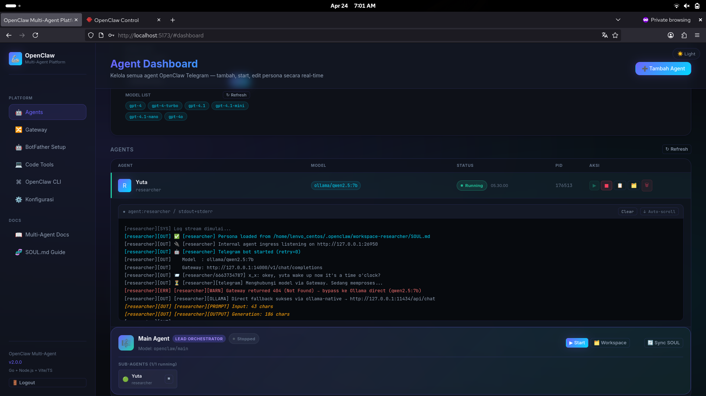

<p align="center">
  <h1 align="center">🐾 OpenClaw Multi-Agent Platform</h1>
  <p align="center">
    <strong>Pusat kendali terpusat untuk menjalankan dan mengelola multiple OpenClaw AI Agents.</strong>
  </p>
</p>

---

## 📖 Apa itu OpenClaw Multi-Agent Platform?



Platform ini adalah **orchestrator** (pusat kendali) yang memungkinkan Anda untuk menjalankan, memonitor, dan mengonfigurasi banyak **Agent AI Telegram (OpenClaw)** secara bersamaan di atas satu perangkat/server, semuanya melalui **web dashboard** yang bersih dan modern.

Daripada menjalankan skrip bot satu per satu di terminal yang terpisah, platform ini menyatukan semuanya. Anda dapat dengan mudah melakukan *start/stop* agen, melihat *live logs*, mengedit kepribadian agen, hingga mengatur memori jangka panjang mereka—semua dari antarmuka web.

## ✨ Fitur Utama

- 🤖 **Multi-Agent Orchestration**: Jalankan berbagai agen AI dengan persona dan tugas yang berbeda secara paralel.
- 🎛️ **Web Dashboard Interaktif**: UI modern (Vite) untuk kendali penuh atas semua agen secara real-time.
- 🧠 **Cognitive Persistence Memory**: Integrasi dengan **PostgreSQL + pgvector** untuk memberikan agen ingatan jangka panjang (RAG / Semantic Memory).
- 📡 **Live Telemetry & Logs**: Pantau aktivitas & pemikiran LLM tiap agen secara live via Server-Sent Events (SSE).
- 🎭 **Dynamic Persona Management**: Edit *SOUL.md* (prompt persona) masing-masing agen langsung dari dashboard.
- 🛡️ **Secure Architecture**: Backend tangguh dengan Go (Golang). Kredensial (Token, API Key) dikelola secara terpisah dan aman.

---

## 🏗️ Arsitektur Sistem

```
OpenClaw Gateway (:14000)  ←  Jantung AI engine (LLM Routing)
        ↑ HTTP
Go API Server (:8080)       ←  Process manager, SOUL.md editor, SSE logs
        ↑ REST + SSE
Vite+TS Dashboard (:5173)   ←  Web UI (start/stop agent, edit persona, live logs)
        +
Node.js Bot Runners          ←  Satu proses per agent, di-spawn oleh Go
        ↑ Telegram API
Telegram Bots               ←  Satu bot token per agent (dari BotFather)
```

## 📁 Struktur Direktori

```
multiagentp/
├── credentials/          🔒 SEMUA credential (dalam .gitignore)
│   ├── .env              Global: GW_URL, GW_TOKEN, port
│   └── agents/
│       ├── main.env      Token Telegram + model config
│       ├── dev.env
│       └── alpha.env
├── backend/              Go API server
│   ├── main.go
│   ├── handlers/         HTTP route handlers
│   └── internal/         Config loader, process manager, openclaw client
├── bots/                 Node.js bot runners
│   ├── shared/base-bot.js  Generic bot logic (no hardcoded creds)
│   ├── shared/memory.js    Cognitive Memory dengan pgvector
│   └── agents/{main,dev,alpha}/index.js
├── frontend/             Vite + TypeScript dashboard
│   └── src/
│       ├── components/   AgentCard, LogViewer, PersonaEditor, StatusBar
│       └── pages/        Dashboard, ConfigPage
├── openclaw-configs/     SOUL.md persona per agent
│   ├── main/SOUL.md
│   ├── dev/SOUL.md
│   └── alpha/SOUL.md
└── scripts/
    ├── setup.sh          Install semua dependencies
    ├── start-all.sh      Start backend + frontend + database
    └── stop-all.sh       Stop semua proses
```

---

## 🚀 Quick Start

### 1. Kebutuhan Sistem & OpenClaw
Pastikan Anda memiliki Node.js v22+, Go v1.22+, dan PostgreSQL dengan ekstensi `pgvector`.
Jika belum memiliki OpenClaw Gateway:
```bash
curl -fsSL https://openclaw.ai/install.sh | bash
openclaw gateway start
```

### 2. Setup Platform
```bash
cd multiagentp
bash scripts/setup.sh
```

### 3. Konfigurasi Credentials

Edit file-file di `credentials/` (File ini sengaja diabaikan oleh Git untuk keamanan):

**`credentials/.env`** — edit `BOTS_DIR` ke path absolut:
```env
BOTS_DIR=/home/lenvo_centos/Documents/js/multiagentp/bots
```

**`credentials/agents/main.env`** — isi token bot:
```env
TELEGRAM_BOT_TOKEN=<token dari BotFather>
```

> *Tip: Untuk agent `dev` dan `alpha`: buat bot baru via `@BotFather` → edit `credentials/agents/dev.env` dan `alpha.env`.*

### 4. Daftarkan Agent ke OpenClaw Gateway

Edit konfigurasi utama di `~/.openclaw/openclaw.json`:
```json
{
  "agents": {
    "list": [
      { "id": "main",  "workspace": "~/.openclaw/workspace-main" },
      { "id": "dev",   "workspace": "~/.openclaw/workspace-dev" },
      { "id": "alpha", "workspace": "~/.openclaw/workspace-alpha" }
    ]
  },
  "bindings": [
    { "agentId": "main",  "match": { "channel": "telegram", "accountId": "main" } },
    { "agentId": "dev",   "match": { "channel": "telegram", "accountId": "dev" } },
    { "agentId": "alpha", "match": { "channel": "telegram", "accountId": "alpha" } }
  ],
  "channels": {
    "telegram": {
      "accounts": {
        "main":  { "botToken": "TOKEN_MAIN",  "dmPolicy": "pairing" },
        "dev":   { "botToken": "TOKEN_DEV",   "dmPolicy": "pairing" },
        "alpha": { "botToken": "TOKEN_ALPHA", "dmPolicy": "pairing" }
      }
    }
  }
}
```

Lalu restart gateway OpenClaw:
```bash
openclaw gateway restart
```

### 5. Start Platform
Proyek ini dilengkapi dengan `Makefile` untuk mempermudah operasional:
```bash
make start
```

Buka browser Anda dan akses Dashboard di: **http://localhost:5173**

---

## 🌐 API Endpoints

| Method | Path | Deskripsi |
|--------|------|-----------|
| GET | `/api/health` | Status backend |
| GET | `/api/agents` | List semua agent |
| POST | `/api/agents/:id/start` | Start bot runner |
| POST | `/api/agents/:id/stop` | Stop bot runner |
| GET | `/api/agents/:id/status` | Status agent |
| GET | `/api/agents/:id/logs` | SSE log stream |
| GET | `/api/agents/:id/persona` | Baca SOUL.md |
| PUT | `/api/agents/:id/persona` | Update SOUL.md |

## 🧬 Personas (SOUL.md)

Tiap agent punya persona berbeda di `openclaw-configs/<id>/SOUL.md`:

| Agent | Persona | Gaya |
|-------|---------|------|
| `main` | General Assistant | Hangat, helpful, santai |
| `dev` | Developer Agent | Teknikal, concise, opinionated |
| `alpha` | Alpha Tester | Blunt, adversarial, tidak sugarcoat |

Edit persona via web dashboard → tombol **✏ Persona** pada card agent.

## 🔒 Security

- **Tidak ada credential dalam kode** — semua dibaca dari `credentials/`.
- Folder `credentials/` berada dalam `.gitignore` — aman dari insiden *git commit*.
- Go backend melakukan *inject environment variables* ke proses Node.js saat proses di-spawn.
- Tiap agen memiliki token Telegram terpisah, memastikan tidak ada percakapan yang bocor lintas agen.

## ⚙️ Development

```bash
# Backend (Go)
cd backend
make dev                    # Run dengan live reload

# Frontend (Vite)
cd frontend
npm run dev                 # Berjalan di http://localhost:5173

# Bot runner manual (untuk debugging & test)
cd bots
export $(cat ../credentials/.env | xargs)
export $(cat ../credentials/agents/main.env | xargs)
export SOUL_MD_PATH=../openclaw-configs/main/SOUL.md
node agents/main/index.js
```

## 📋 Tech Stack (Detail)

| Layer | Teknologi | Alasan Pemilihan |
|-------|-----------|------------------|
| Backend API | **Go 1.22+** | Native process management, goroutines, memory rendah (~10MB), static binary. |
| Bot Runners | **Node.js 22** | Menjalankan SDK OpenClaw secara native. |
| Frontend | **Vite + TypeScript** | Keamanan tipe data (Type safety) dan HMR yang sangat cepat. |
| CSS | **Vanilla CSS** | Desain yang sangat ringan dengan *glassmorphism* tanpa *dependency* berat. |
| Config | **dotenv (.env)** | Isolasi environment dan keamanan *credential*. |
